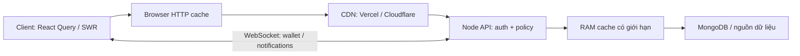

# Cache và đường truyền dữ liệu



Không có Redis (gỡ 31/10/2026): Render free chạy đúng một tiến trình Node, nên
RAM của tiến trình đó là đủ và bớt một dịch vụ có thể sập hoặc hết hạn mức.
Trình duyệt gọi cùng origin `/api/*`; Python chỉ được Node gọi. Request ghi, tài
khoản, JOY và xác thực đi tới API để kiểm tra quyền và xử lý bằng nguồn thật.

## Phần đã thực hiện trong mã nguồn

- `apps/server/utils/cacheHelper.js` đệm JSON công khai đã lọc: hồ sơ công khai theo
  slug/tên miền, dữ liệu portfolio, danh mục gói và bảng xếp hạng cờ. Mã đổi quà
  nằm riêng ở `GET /api/packages/admin` có `requireAdmin`, không vào cache.
- Dữ liệu fresh theo TTL của caller; dữ liệu stale được trả ngay và làm mới nền.
  Hết 3 lần TTL, tối đa 5 phút, phải đọc nguồn thành công — không trả dữ liệu cũ
  vô hạn khi MongoDB lỗi.
- Request cùng key được gom chung (single-flight). Tối đa 1000 key, FIFO.
- `clearCache` tăng thế hệ của key: lượt tải cũ đang chạy không nạp lại được bản
  vừa bị xoá. Xoá cache hồ sơ bao gồm slug và tên miền riêng.
- `cachePolicy` chạy trước các middleware khác. Response mặc định là
  `private, no-store`; lỗi, request ghi, request có Cookie/Authorization hoặc
  response Set-Cookie luôn bị chặn cache ở browser, Vercel và Cloudflare.
- API dùng Workbox `NetworkOnly`, vẫn hưởng HTTP cache theo header server.
  Thay đổi worker chỉ tới thiết bị sau build + deploy.
- Kiểm tra: `node apps/server/scripts/check-response-cache.mjs`.

## Giới hạn nhất quán

Đây là cache cho dữ liệu công khai chấp nhận trễ, không phải kho dữ liệu giao
dịch. Không dùng helper cho số dư, quyền truy cập, mã đổi quà hoặc quyết định
thanh toán.

Xoá cache origin không purge bản CDN đang lưu. Các route public chính giữ
`max-age=0, s-maxage=60, stale-while-revalidate=120`; dữ liệu ở edge có thể
cũ thêm 180 giây so với bản origin đã nhận. Các TTL ở nhiều tầng có thể cộng
dồn. Muốn thu hồi nội dung ngay phải purge cả CDN; thông tin cần thu hồi ngay
không nên dùng policy này. Header origin không thay thế cấu hình bypass tại
edge, vì cache hit ở edge xảy ra trước khi Node nhận request.

## Cấu hình triển khai

1. Vercel phục vụ frontend và assets theo `vercel.json`. API proxy giữ header
   từ Node; không đặt cache công khai chung cho `/api/*`.
2. Cloudflare trước API: bypass cache với method ngoài GET/HEAD, request có
   Authorization hoặc Cookie; chỉ bật cache API cho allowlist GET công khai
   đã rà soát, ví dụ `/api/data`, `/api/packages`, `/api/bios/slug/*`,
   `/api/bios/by-domain/*`. Tôn trọng Origin Cache Control và TTL từ response.
   Không dùng Edge TTL override để bỏ qua `private`/`no-store`; không bật
   cache errors. Các rule bypass phải có hiệu lực cuối cùng theo thứ tự rule.
3. Purge cache API cũ khi triển khai lần đầu, nhất là `/api/packages` vì bản
   trước có thể chứa mã đổi quà. Bản worker mới tự xoá CacheStorage cũ khi
   activate; cache CDN cần purge tại nhà cung cấp.
4. Kiểm tra staging bằng hai tài khoản và cửa sổ ẩn danh: cookie/token luôn
   bypass; anonymous GET công khai mới có thể HIT. Xem `Age`, `CF-Cache-Status`
   hoặc `X-Vercel-Cache`. Các check local không chứng minh CDN đã cấu hình đúng.

## Kiểm chứng

```bash
node apps/server/scripts/check-cache-headers.mjs
node apps/server/scripts/check-response-cache.mjs
npm run check:all
```

Check HTTP dùng middleware thật để kiểm cookie, token, Set-Cookie, lỗi, POST,
GET/HEAD công khai và đường dẫn giả đuôi tài nguyên. Check cache dùng helper
thật để kiểm single-flight, invalidation khi đang tải, SWR, hết hạn cứng và
lỗi nguồn.

Tài liệu nhà cung cấp:
[Vercel CDN cache](https://vercel.com/docs/caching/cdn-cache),
[Cloudflare Origin Cache Control](https://developers.cloudflare.com/cache/concepts/cache-control/).
